<picture>
  <source media="(prefers-color-scheme: dark)" srcset="assets/hero.svg">
  
</picture>

  &nbsp;
  &nbsp;
  

  
  
  
  

---

Sou desenvolvedor sênior de back-end em Python e sistemas cloud native na AWS. Hoje construo **agentes autônomos** com Agno, LangChain e Amazon Bedrock, com RAG, bancos vetoriais e times de agentes, para diferentes segmentos de mercado, e trabalho com agentes de IA também na própria escrita de código. Também liderei uma solução de autenticação de chamadas que combate spoofing no setor de telecom.

Comecei pela pesquisa: em 2018, na iniciação científica, trabalhei com reconhecimento facial, identificação de comportamentos humanos com IA e simulação de redes de sensores sem fio; NLP, análise de sentimento e chatbots vieram no estágio na Stefanini. Meu TCC foi uma plataforma de *Machine Learning as a Service*. Este perfil junta as duas pontas: os projetos de agora e o laboratório de ML que veio antes.

<picture>
  
</picture>

> [!NOTE]
> **Versão interativa.** Aqui no README as animações rodam, mas o GitHub bloqueia o mouse sobre imagens, então o passar do mouse (detalhes, realces, tooltips) não funciona nesta página. Para usar: clique na imagem, na página do arquivo escolha **Download raw file** (ou clone o repositório) e abra o `.svg` salvo direto no navegador (arraste o arquivo para uma aba ou use *Abrir com*). Vale para todos os gráficos e diagramas abaixo.

<b>Stack em texto (badges copiáveis)</b>

 

<!-- stack-badges:start -->
**IA aplicada** 

  
**Dev com IA** 

  
**Linguagens** 

  
**Cloud AWS** 

  
**Infra e DevOps** 

  
**Dados** 

  
**Arquitetura** 

  
<!-- stack-badges:end -->

<picture>
  
</picture>

Versão interativa: veja a nota na seção 01 (barras e pontos mostram detalhes ao passar o mouse). Linguagens contadas quando passam de 1% dos bytes do repositório; os exemplos listados são só de repositórios públicos.

<picture>
  
</picture>

Versão interativa: veja a nota na seção 01 (cada ponto mostra o detalhe do marco).

<b>Pesquisa e formação</b>

 

- **Reconhecimento e identificação facial em vídeo com Machine Learning**, iniciação científica (CNPq), 2018–2019. Prêmio Destaque de Iniciação Científica, Universidade de Brasília, 2019.
- **Identificação de comportamentos humanos com IA**, iniciação científica (CNPq), 2018.
- **Simulação de algoritmos de reconfiguração de uma RSSF**, iniciação científica (IESB), 2018.
- **Bengala multissensorial**, artigo em coautoria no Seminário Nacional de Inclusão Digital (SENID), 2018.
- **Pós-graduação em Engenharia de IA Aplicada**, UNIPDS, em andamento.
- **Bacharelado em Ciência da Computação**, IESB, 06/2020.
- **Técnico em Redes de Computadores**, IESB, 06/2015.

<picture>
  
</picture>

Versão interativa: veja a nota na seção 01 (cada nó mostra o que acontece na etapa e realça as setas ligadas a ele).

Uso um fluxo padronizado de codificação com agentes de IA, e a versão empacotada dele é a **guilda**: um time de engenharia de IA para Claude Code e Codex em que o principal (a sessão de quem pede) orquestra e nunca implementa nem dá parecer de especialista. Cada pedido vira história, spec e plano aprovados, é executado por especialistas escolhidos pela expertise e só avança depois de gates independentes sobre o mesmo snapshot. O Kiro entra no meu dia a dia pelo kit [setup_kiro](https://github.com/allankltsn/setup_kiro), que é separado da guilda.

- **Ninguém revisa a própria entrega.** Expertise e função são separadas: autor, consultor, QA, revisor de conformidade, revisor técnico, segurança, privacidade e verificador são papéis distintos.
- **Nada vira código sem história, spec e plano.** A história traz Given/When/Then e uma DoR de 9 itens, a spec é proporcional ao risco e o plano divide o trabalho em pacotes com escopo de escrita disjunto.
- **Camada de modelo por despacho.** Deep, standard ou light, escolhida por cinco sinais (impacto, ambiguidade, contexto, falha anterior e custo do erro). Gate nunca roda abaixo de standard.
- **Gates independentes, no mesmo snapshot.** Conformidade, técnica e segurança são obrigatórias, e o QA adversarial roda por último. Privacidade (com veto nas decisões de design e usabilidade), design e usabilidade entram quando cabem.
- **Achado tem ID estável e laço de correção.** A correção traz evidência (falhava antes, passa depois), outro especialista confirma e os gates afetados rodam de novo. Critical/High bloqueiam a conclusão (completed), salvo decisão de risco explícita.
- **Silêncio não é aprovação.** Timeout, impasse, validador ausente e orçamento esgotado nunca aprovam. O aceite humano é separado, e a tag SemVer sai antes de o código entrar na main.
- **Suporte contínuo.** Quadro no GitHub Projects com validação dupla, economia de tokens que muda como executa e nunca o que verifica, continuidade de sessão e registro de tudo que é instalado.

Mesma nota de versão interativa da seção 01. Código, versões e testes: [allankltsn/guilda](https://github.com/allankltsn/guilda), versão v2.0.0.

<picture>
  
</picture>

  
  

  
  

  
  

<picture>
  
</picture>

  
  

  
  

<picture>
  
</picture>

  
  

  
  

  
  

  

<picture>
  
</picture>

  
  

  
  

---

  Aberto a conversas sobre agentes de IA, arquitetura cloud e back-end. O caminho mais rápido é o <a href="https://www.linkedin.com/in/allan-kleitson-teotonio-5339a3b2">LinkedIn</a>.

