<picture>
  <source media="(prefers-color-scheme: dark)" srcset="assets/hero.svg">
  
</picture>

  &nbsp;
  &nbsp;
  

  
  
  
  

---

Sou desenvolvedor sênior de back-end em Python e sistemas cloud native na AWS. Hoje construo **agentes autônomos** com Agno, LangChain e Amazon Bedrock, com RAG, bancos vetoriais e times de agentes, para diferentes segmentos de mercado. Também liderei uma solução de autenticação de chamadas que combate spoofing no setor de telecom.

Comecei pela pesquisa: em 2018 já treinava modelos de visão computacional e NLP na iniciação científica, e meu TCC foi uma plataforma de *Machine Learning as a Service*. Este perfil junta as duas pontas: os projetos de agora e o laboratório de ML que veio antes.

<picture>
  
</picture>

<table>
  <tr>
    <td><b>IA aplicada</b></td>
    <td>
      
      
      
      
      
      
      
    </td>
  </tr>
  <tr>
    <td><b>Dev com IA</b></td>
    <td>
      
      
      
      
    </td>
  </tr>
  <tr>
    <td><b>Linguagens</b></td>
    <td>
      
      
      
      
      
      
      
      
    </td>
  </tr>
  <tr>
    <td><b>Cloud AWS</b></td>
    <td>
      
      
      
      
      
      
      
    </td>
  </tr>
  <tr>
    <td><b>Infra e DevOps</b></td>
    <td>
      
      
      
      
      
      
    </td>
  </tr>
  <tr>
    <td><b>Dados</b></td>
    <td>
      
      
      
      
    </td>
  </tr>
  <tr>
    <td><b>Arquitetura</b></td>
    <td>
      
      
      
      
    </td>
  </tr>
</table>

<picture>
  
</picture>

<picture>
  
</picture>

<picture>
  
</picture>

<picture>
  
</picture>

<b>Pesquisa e formação</b>

 

- **Reconhecimento e identificação facial em vídeo com Machine Learning**, iniciação científica (CNPq), 2018–2019. Prêmio Destaque de Iniciação Científica, Universidade de Brasília, 2019.
- **Identificação de comportamentos humanos com IA**, iniciação científica (CNPq), 2018.
- **Simulação de algoritmos de reconfiguração de uma RSSF**, iniciação científica (IESB), 2018.
- **Bengala multissensorial**, artigo em coautoria no Seminário Nacional de Inclusão Digital (SENID), 2018.
- **Pós-graduação em Engenharia de IA Aplicada**, UNIPDS, em andamento.
- **Bacharelado em Ciência da Computação**, IESB, 2020.

<picture>
  
</picture>

<picture>
  
</picture>

Nada vira código antes de história, spec e plano aprovados. Depois, um agente gestor distribui o trabalho entre especialistas, escolhe o modelo pelo custo e pela complexidade de cada tarefa, e a entrega só sai depois de revisões independentes. Uso esse fluxo no dia a dia com Claude Code, Codex e Kiro, e os repositórios abaixo são a versão empacotada dele.

<picture>
  
</picture>

  
  

  
  

  
  

<picture>
  
</picture>

  
  

  
  

<picture>
  
</picture>

  
  

  
  

  
  

  

<picture>
  
</picture>

  
  

  
  

---

  Aberto a conversas sobre agentes de IA, arquitetura cloud e back-end. O caminho mais rápido é o <a href="https://www.linkedin.com/in/allan-kleitson-teotonio-5339a3b2">LinkedIn</a>.

